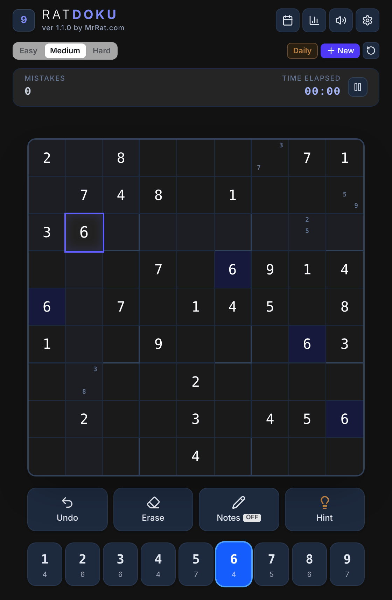

<div align="center">
  
# RatDoku

A sleek, high-performance Sudoku game and Progressive Web App (PWA) by **MrRat.com** with daily challenges, multiple difficulty levels, logical smart hints, offline support, and statistics tracking.

### [Play it in your browser](https://github.mrrat.org/RatDoku/)

by [MrRat Gaming](https://github.mrrat.org/) &nbsp;·&nbsp; [Discord](https://discord.gg/FybAhsxQHZ)



</div>

## Features

- **Progressive Web App (PWA)**: Installable on iOS, Android, macOS, Windows, and Linux with full offline gameplay support.
- **Game Modes**: Classic mode (Easy, Medium, Hard) and Daily Challenges with calendar history and streak tracking.
- **Smart Hint System**: Step-by-step logical hints (Naked Singles, Hidden Singles, Block Intersections, Naked Pairs, and more) with visual explanations.
- **Languages**: English, Español, Français, Deutsch, 日本語, 한국어, 简体中文, 繁體中文 and Mandarin in Pīnyīn, chosen from the dropdown under Settings. By default the game follows the device language (for example, Japanese phones get 日本語, and Taiwan and Hong Kong phones get 繁體中文).
- **Customizable Themes**: Elegant Dark (obsidian), Minimal Light, Warm Paper, Dark Slate, and Nordic Forest.
- **Rich Gameplay Controls**: Undo, candidate pencil notes, auto-error checking, matching number highlights, peer highlights, sound effects, and timer controls.
- **100% Client-Side & Offline-First**: No external API, fonts or cloud dependency. After the first visit the whole game is saved on the device and starts from there instantly, even with no connection or a filtered one (such as in mainland China); updates download in the background when a connection is available. All game state and daily puzzles stay in the browser.

---

## Playing on GitHub Pages

Every push to `main` also builds RatDoku and publishes it to GitHub Pages at **https://github.mrrat.org/RatDoku/** (workflow: `.github/workflows/pages.yml`). The build uses relative paths, so the same output works at a site root (Docker) or under `/RatDoku/` (Pages). One-time setup: in the repo's **Settings → Pages**, set **Source** to **GitHub Actions**.

### Standalone single-file version

Every build also makes **`RatDoku.html`**: the whole game in one HTML file that can be saved and opened straight from disk, with no internet needed. Get it from **[RatDoku.html](RatDoku.html)** in this repository (open it, then use **Download raw file**). It is not part of the website. `npm run build` refreshes it, so commit `RatDoku.html` along with any code change. It plays fully, including daily puzzles, hints and every language. It can't be installed as an app, and its saved games and stats are kept separately from the website's. Offline, it uses the device's own fonts.

---

## Deploying with Portainer (from GitHub)

GitHub builds RatDoku into a ready-made Docker image every time `main` changes and publishes it at `ghcr.io/misterrat/ratdoku`. Portainer just downloads that image and starts it, so nothing is built on your server and no files need to be copied or edited.

### Create the stack
1. Open Portainer and select your environment.
2. Click **Stacks** in the left sidebar, then **+ Add stack**.
3. **Name**: `ratdoku` (lowercase).
4. **Build method**: choose **Repository**.
5. **Repository URL**: `https://github.com/MisterRat/RatDoku`
6. **Repository reference**: `refs/heads/main`
7. **Compose path**: `docker-compose.yml`
8. Optional: under **Environment variables**, add `PORT` to use a port other than the default `3030`.
9. Click **Deploy the stack**, then open `http://<your-server-ip>:3030`.

### Updating to a new version
Open the stack in Portainer, click **Pull and redeploy**, and make sure **Re-pull image** is switched on. Portainer downloads the newest image that GitHub built from `main`.

### Where game data is kept
RatDoku has no server-side data. Saved games, settings, stats and streaks are stored in each player's browser for the address they use, so redeploying or updating the container never touches them. Keep the same address and port to keep players' progress.

### Alternative: Docker Compose from the command line
```bash
git clone https://github.com/MisterRat/RatDoku.git
cd RatDoku
docker compose up -d                                        # use the published image
docker compose -f docker-compose.build.yml up -d --build    # or build it yourself
```

Then open `http://localhost:3030` (or the `PORT` you set).

---

## Local Development

```bash
# Install the exact locked dependency versions
npm ci

# Start Vite dev server on port 3000
npm run dev

# Type-check and run the puzzle generator tests
npm run lint
npm test

# Build for production
npm run build
```

### Versioning

The version shown in the app header and settings comes from `version` in `package.json`. It has two parts, `MAJOR.MINOR` (for example `1.3`): the major number is set by hand, and the minor number goes up with every push. To also publish a versioned Docker image, push a matching tag such as `v1.3`.

### Continuous integration

Every push and pull request runs the type-check and tests. The container image is only built and published to `ghcr.io/misterrat/ratdoku` after they pass.

### Daily puzzles

Daily challenges are generated from a seed made from the date and difficulty, so every player gets the same grid. A test pins the output for a fixed date; if a generator change makes it fail, that change would alter everyone's past and future daily puzzles.

---

### Adding a language

All on-screen text lives in `src/i18n/`. To add a language:

1. Copy `src/i18n/en.ts` to a new file (e.g. `es.ts`), translate the values, and keep the keys and `{placeholders}` as they are. Type it as `Messages`; `npm run lint` then lists any text you missed.
2. Add an entry to `LANGUAGES` in `src/i18n/languages.ts`: its code, its name in its own language, and which device languages should pick it automatically.

It then appears in the Settings → Language dropdown.

---

## License

RatDoku is released under the [MIT License](LICENSE).
